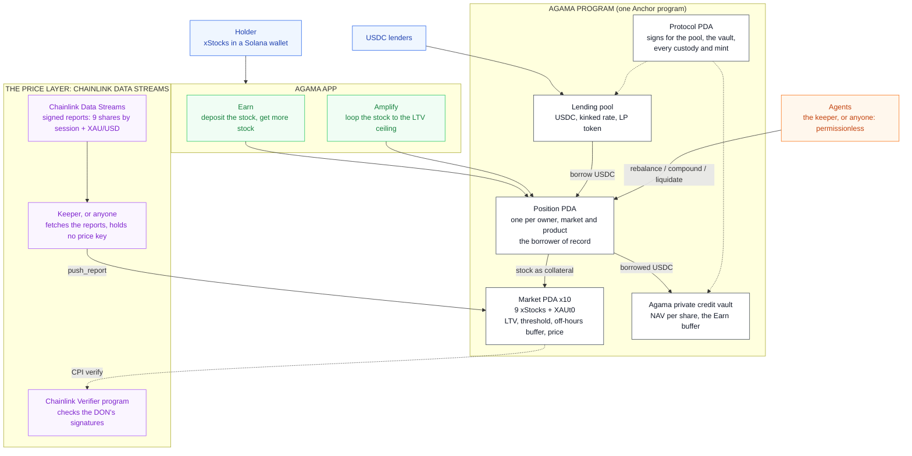

# Agama: make tokenized stocks productive on Solana

Deposit a tokenized stock, get more of it back. Live on **Solana devnet**.

The xStocks (TSLAx, NVDAx, AAPLx, SPYx, QQQx, GOOGLx, MSFTx, AMZNx, METAx) and
Tether Gold (XAUt0) are native tokens on Solana and trade around the
clock, yet a holder can only hold them. Agama turns
them into a position that grows: deposit the stock, the protocol borrows USDC
against it, puts the USDC to work in the Agama private credit vault, and
permissionless agents turn the yield back into **more of the stock**. What
grows is your share count, not a stablecoin balance.

## Try it

| | |
|---|---|
| Demo video | https://youtu.be/M5GXPA1J31w (2:22) |
| Live app | https://app.agama.finance/solana (Solana devnet; Phantom, Backpack or Solflare) |
| Program | [`6YdZN72p68ynpGH1SwZ86EseFokch6zPAQPAq9NxPY7D`](https://explorer.solana.com/address/6YdZN72p68ynpGH1SwZ86EseFokch6zPAQPAq9NxPY7D?cluster=devnet) on **devnet** |

**Try it without help.** Open the app with Phantom, Backpack or Solflare set to
devnet (a little devnet SOL from faucet.solana.com pays the fees), hit **Faucet** (USDC, the nine
stocks and XAUt0 land straight into your private balance), then **Earn**: pick a
stock, an amount and a level, deposit. Your position appears with its borrow,
its vault share and the agents keeping it on target; **Amplify** loops a stock
to a multiple; **Portfolio** decrypts your private balances on demand.

## Why Solana

- **The core logic is on chain, in one Anchor program.** Positions are PDAs
  seeded by owner, market and product; the lending pool, the private credit
  vault, borrowing, liquidation, bad debt and price bounds are all program
  rules. `earn_deposit` borrows and fills the vault in one instruction,
  `amplify_open` borrows and buys more of the same stock in one instruction.
- **Private by default, natively.** Every token is a Token-2022 mint with the
  confidential transfer extension: balances and transfer amounts are ElGamal
  ciphertexts, and the zero knowledge proofs are verified on chain by Solana's
  ZK ElGamal proof program. A stranger reads zero.
- **The assets are already here.** xStocks and gold tokens are native Token-2022
  tokens on Solana, trading around the clock. On mainnet the swap leg is a
  Jupiter route.
- **Agents need cheap, fast blocks.** `rebalance`, `compound` and `liquidate`
  are permissionless; at Solana fees and finality, keeping every position on
  target minute by minute is viable for anyone.
- **Tested like a program, not a demo.** 16 LiteSVM flows (two through Chainlink's own Verifier), end to end runs on a
  local validator and on devnet, and a browser end to end on the live app.

**What was built, and when.** The core of this repository (the Anchor program,
the Token-2022 confidential balance flows, the Data Streams integration, the web
app and the tests) was written on 6 and 7 October 2026, at TOKEN2049 Origins,
where it placed second on the Solana track. Since then: the always-on keeper and
its monitoring, and prices moved to Chainlink Data Streams reports verified on
chain by Chainlink's Verifier (the git history has every step). The first
commit lands the program and its tests in one piece (they were iterated
locally before the repository was created); the program's first transaction on
devnet is from 6 October, 05:00 UTC. The product design is not new: it is the one Agama shipped on
X Layer (EVM, Solidity) for OKX Dev Day,
[agamafinance/agama-xlayer](https://github.com/agamafinance/agama-xlayer). The
web app reuses Agama's visual identity and component styling from that app.

## Architecture



## What it does

- **Earn.** One deposit and one slider. The program borrows USDC up to the
  level you pick and puts it in the vault, in the same instruction. From then on
  the agents hold the level: the stock rises, they borrow the difference; it
  falls, they repay out of the vault shares, **never by selling your stock**.
  The yield above the debt is bought back as more stock (`compound`).
- **Amplify.** One slider. `amplify_open` borrows against the stock and buys
  more of the same stock in one instruction, no loop of hops: a loop at L times
  carries an LTV of `(L - 1) / L`, so the market's own LTV is the ceiling
  (1.43x on TSLA and NVDA, 1.54x on AAPL, 2x on SPY). The agents hold the
  multiple both ways.
- **Lend.** The pool is seeded by the protocol on devnet; the app no longer
  has a Lend tab, the `supply` / `withdraw` instructions remain.
- **The buffer goes before the liquidator.** `liquidate` first repays out of
  the position's vault shares; only if that does not restore health does the
  liquidator repay half the debt and take stock at a 5% bonus.
- **Priced by Chainlink, verified on chain.** Every price is a signed Chainlink
  Data Streams report (the xStocks' own data provider) that the program has
  Chainlink's Verifier check before applying it: each share in its live
  session (regular, extended or overnight), the last close when the market is
  shut. Outside regular hours a market is flagged off-hours, so LTV and
  threshold both tighten by 5 points. A price moves 15% at most per
  update, publish times only move forward, and only a stale price stops a
  borrow.
- **No buttons for the automation.** Every position records which agent last
  acted, what it did and when. `rebalance`, `compound` and `liquidate` take any
  signer; the keeper is one caller among many.

### Solana, not a port line by line

On X Layer every user gets an EIP-1167 account contract and the routers call
into it. On Solana the account is a PDA (`position`, seeded by owner, market and
product), so there is nothing to clone and no router to trust: the owner's
signature derives the address. The X Layer `compoundIntoStock` needed the caller
to pass the exact swap amount and calldata, with an on-chain slippage floor
against griefing; here the swap is priced inside the instruction off the same
oracle, so an agent has nothing to choose and nothing to skim.

## Confidential balances

Every token Agama mints (USDC, the nine xStocks, XAUt0, the LP token) is a Token-2022
mint with the **confidential transfer extension**. A holder can move any of
them into an encrypted balance and send them to anyone without the amount ever
appearing on chain: balances and transfer amounts are ElGamal ciphertexts, and
the ZK proofs that keep them honest (no negative balances, no minted value)
are checked on chain by Solana's ZK ElGamal proof program.

| | Public | Private |
|---|---|---|
| What you hold of each token | | encrypted, only your keys read it |
| Sending to someone else | | amount hidden from everyone but the two of you |
| Depositing into Earn, Amplify | amount visible | |
| What comes back on close or withdraw | amount visible, then shielded again | |
| Positions (collateral, debt, target) | program state, readable by anyone | |

A program cannot price a loan it cannot read, so positions stay public: what
the encryption hides is everything around them, how much you hold, where it
goes, who you pay. The mints have no auditor key and no authority that could
add one later.

- **Keys.** Derived from one wallet signature over `solana-conf-bal/v1`, the
  standard every Token-2022 client uses, so the same wallet reads the same
  balances in any app.
- **Cost.** Shielding is one transaction (deposit and apply together, the new
  readable balance computed client-side; two the first time a token is set
  up). A private send is five and an unshield four: the range and equality proofs do not fit in one
  transaction, so they are verified into context accounts first and closed
  afterwards, rent back.
- **Rounding never reaches the wallet.** A holder whose USDC is all private has
  zero public USDC, so `earn_close` writes off a rounding gap of up to 0.0001
  USDC between the vault shares and the debt instead of asking the wallet for it.
- **Tooling.** Proofs come from `@solana/zk-sdk` (Anza's WASM build of
  `solana-zk-sdk`) through the Kit client `@solana-program/token-2022/confidential`.
  Local validators need agave 4.3 or later (3.1 rejects these proofs) and
  devnet's Token-2022 build (the genesis copy predates the instruction layout).

`pnpm private-e2e` runs it: shield, private sends, a stranger's view, unshield
into Earn, close and shield back, lend from private, every balance decrypted
and checked exactly.

## Prices: Chainlink Data Streams, verified on chain

A price only reaches a market as a **signed Chainlink Data Streams report,
verified on chain**. `push_report` takes the report as Chainlink signed it,
calls Chainlink's Verifier program (CPI), which checks the Data Streams DON's
signatures and hands the report back, then decodes it and applies the price.
Anyone can send a report; nobody can choose the price.

```
off chain (the keeper, or anyone with Data Streams access)
  Data Streams API     the latest signed report of each feed (HMAC request)
  pick the feed        the shares' marketStatus says which session is live
  push_report          the report, snappy compressed as the Verifier takes it
on chain (push_report)
  Chainlink Verifier   CPI verify: the DON's signatures, or the call fails;
                       the program checks the return data comes from it
  feed                 the report's feed id must be one of the market's (set_feeds)
  session              regular feed: regular hours or closed (the last close);
                       extended feed: pre and post-market; overnight feed: overnight
  fresh                not expired, observed within the last 5 minutes
  apply_price          publish time strictly forward, at most 15% per update
```

- **One feed per session.** A share has three Data Streams feeds (RWA
  Advanced, v11): regular, extended and overnight hours. Every report carries
  the market status; the program only takes the feed that matches it, so an
  overnight price cannot pass for a regular one. Regular hours get the session
  terms, every other session the off-hours ones.
- **Gold is a cross.** XAU/USDT times USDT/USD, two reports (v3) verified in
  the same instruction and multiplied on chain; the market is off-hours from
  Friday 21:00 to Sunday 23:00 UTC.
- **Bounded on chain.** A publish time must be strictly newer than the last
  one, so a report applies once and an old one never; a move larger than 15%
  steps toward the report, 15% per update, and converges.
- **The keeper holds no price key.** It fetches the reports, sends
  `push_report`, and runs the agents (`rebalance`, `compound`, `liquidate`,
  all permissionless). `push_price`, the unverified path, is only open to the
  admin key, for emergencies; the LiteSVM suite still uses it to move prices
  on purpose.
- **Tested against Chainlink's own Verifier.** The LiteSVM suite loads the
  Verifier program and its accounts as deployed on devnet
  (`scripts/fetch-fixtures.sh`) and real reports signed by the testnet DON
  (`tests/fixtures/reports.json`): a report applied, the same report with one
  bit of its price flipped refused by the Verifier (`BadVerification`), a
  fake Verifier, another market's feed, the wrong session, a replay and a
  stale report refused, gold priced from its two reports.

## Where it lives

| | |
|---|---|
| Status | Live on devnet: Token-2022 with confidential balances, priced by Chainlink Data Streams, kept fresh by an always-on keeper. At each deploy the on-chain bytes were dumped and compared to the local build. |
| Program | [`6YdZN72p68ynpGH1SwZ86EseFokch6zPAQPAq9NxPY7D`](https://explorer.solana.com/address/6YdZN72p68ynpGH1SwZ86EseFokch6zPAQPAq9NxPY7D?cluster=devnet) (devnet) |
| Every address | [`deployments/devnet.json`](deployments/devnet.json) |
| IDL | [`idl/agama_solana.json`](idl/agama_solana.json) |
| Test funds | `faucet_usdc` mints 10,000 USDC, `faucet_stock` 10 shares of a market. Devnet SOL at https://faucet.solana.com |

## Devnet, said plainly

- **Stand-in tokens.** USDC, the nine xStocks and XAUt0 are mints the program
  controls, with a public faucet: no xStock or XAUt0 faucet exists on devnet.
  The prices are real: Chainlink Data Streams (testnet), verified on chain.
- **Built to stay up for anyone testing it.** On devnet every market's
  `max_age` is 7 days (mainnet: minutes): the always-on keeper reprices every
  few minutes, and if it ever stops, prices freeze instead of the app refusing
  every deposit. The keeper also refills the USDC pool when faucet collateral
  drains it, and an hourly health check (`.github/workflows/health.yml`) fails
  loudly if a price, a wallet or the app goes wrong.
- **Swaps settle at the oracle price minus 5 bps.** Devnet has no xStock
  liquidity. On mainnet that leg is a Jupiter route.
- **The vault's coupons are minted.** There is no credit book on devnet, so when
  the vault pays out more than it took in, the difference is minted and counted
  in `coupons_paid`. It is the only place the program creates dollars.
- **The session flag comes from the report's `marketStatus`** (gold: the report's time); the price is bounded.
- **Token-2022 throughout**, like the mainnet xStocks.
- **RPC failover.** Public devnet RPCs rate limit (429). The keeper fails over
  across `SOLANA_RPCS` (a keyed Helius endpoint, then MagicBlock's and Solana's
  own) and benches one that limited it for 30 s; the web app relays across
  three public endpoints (`web/lib/solana/rpc.ts`).

## Known limitations

Said plainly, for the judges and for the audit that comes after.

- **The price bound is per update, not per unit of time.** `apply_price`
  moves a price at most 15% per update. Reports are genuine, so this only
  matters for the admin's `push_price`, which could stack updates with rising
  publish times in one transaction. Fix: store the on-chain time of the last
  update in the market and bound the move per minute.
- **A capped price reads as fresh.** While a price converges after a gap
  larger than 15%, the market stores the capped value with the new publish
  time. Fix: a converging flag that pauses new borrows until it clears.
- **Devnet faucets are unlimited and borrowing has no per-market cap**, so
  anyone can borrow the pool dry with faucet collateral; the admin tops it up.
  Mainnet uses real tokens and needs debt ceilings per market.
- **A market shut for the weekend keeps its last close**, while the xStock
  tokens keep trading on Solana. That is what Data Streams reports; the
  off-hours terms (5 points less LTV) are the margin for it.
- **`initialize` is not tied to the upgrade authority** (it was called at
  deploy time); Earn liquidation repays the whole debt from the vault buffer;
  dust collateral left by a liquidation is not written off.
- **Mainnet porting:** real USDC is a classic SPL token while this program is
  Token-2022 only, and the real xStocks use the scaled UI amount extension, so
  amounts must be scaled after corporate actions.

## Run it

```bash
anchor build                      # or: cargo build-sbf --manifest-path programs/agama-solana/Cargo.toml
./scripts/fetch-fixtures.sh && cargo test  # 16 LiteSVM flows, two through Chainlink's Verifier
./scripts/check.sh                # everything CI runs, before pushing
pnpm install
pnpm setup                        # initialize, 10 markets, first prices, seed the pool (idempotent)
pnpm e2e                          # 9 real transactions on devnet from a fresh wallet
pnpm e2e:local                    # throwaway validator: setup, the e2e, the agents through
                                  # the real keeper with prices moved on purpose (17 checks),
                                  # then the private path (12 checks). VALIDATOR=agave 4.3+
pnpm state                        # live pool, vault, prices and their age, positions, keeper
pnpm keeper                       # the keeper: verified Data Streams reports and the agents
pnpm tsx scripts/datastreams-check.ts  # the latest Data Streams report of every feed
```

The LiteSVM suite (`programs/agama-solana/tests/flows.rs`) covers: Earn opening
at the level with the USDC landing in the vault; the agents holding the level
both ways without touching the stock; half a year of yield coming back as more
stock and a close returning it; a close after interest outran the yield taking
the shortfall from the wallet; Amplify looping to the multiple, holding it
through a rally and a drop, and unwinding; the buffer going before the
liquidator; an Amplify loop liquidated at the bonus; lenders earning the rate
and not withdrawing lent cash; the price bounds (keeper only, 15% per push,
publish time, staleness, off-hours terms); the slider.

## The app

`web/` is the Agama app with Solana as its platform: Portfolio, Earn, Amplify
and a Faucet under `/solana`, for Phantom, Solflare, Backpack or any injected
wallet. **Private by default**: one signature unlocks the confidential keys,
the faucet's tokens are shielded as they land, a deposit unshields exactly
what it needs right before it, and whatever a close returns is shielded again.
`cd web && pnpm dev` serves it on http://localhost:3031/solana.
`web/scripts/ui-e2e.mjs` drives it in a headless browser with a throwaway
signer, every click a real devnet transaction.

## Instructions

| | Who | What |
|---|---|---|
| `initialize`, `add_market`, `set_params`, `set_market` | admin | Protocol, mints, pool and vault accounts; markets and their terms |
| `set_feeds` | admin | A market's Data Streams feeds and the Chainlink Verifier |
| `push_report` | anyone | A market's price from signed Data Streams reports, verified by CPI into Chainlink's Verifier; bounded |
| `push_price` | admin key (emergency) | An unverified price; same bounds |
| `faucet_usdc`, `faucet_stock` | anyone | Devnet funds |
| `supply`, `withdraw` | lender | USDC in and out of the pool, LP token |
| `earn_deposit`, `earn_set_target`, `earn_close` | owner | Open or top up at a level, move the slider, close |
| `amplify_open`, `amplify_close` | owner | Loop to a multiple in one instruction, unwind |
| `rebalance`, `compound`, `liquidate`, `poke` | anyone | The agents |
